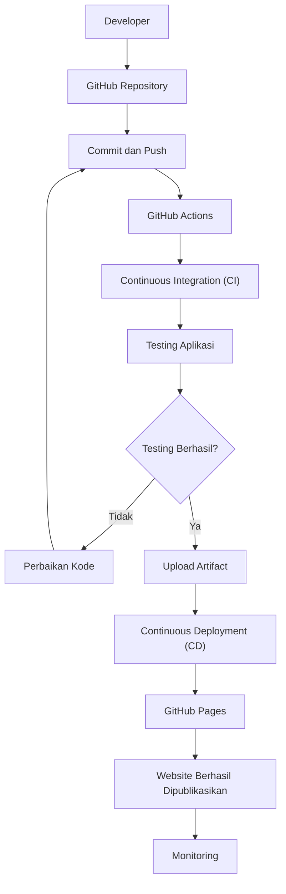

# DIAGRAM CI/CD DEVOPS

## Alur Kolaborasi Developer

Diagram berikut menjelaskan proses CI/CD menggunakan GitHub Actions.

## Penjelasan

1. Developer membuat dan mengubah kode program.
2. Kode dikirim ke GitHub melalui Commit dan Push.
3. GitHub Actions menjalankan proses CI.
4. Sistem melakukan pengujian kode.
5. Jika pengujian berhasil, proses CD dijalankan.
6. Website dipublikasikan menggunakan GitHub Pages.
7. Developer melakukan monitoring terhadap website.
