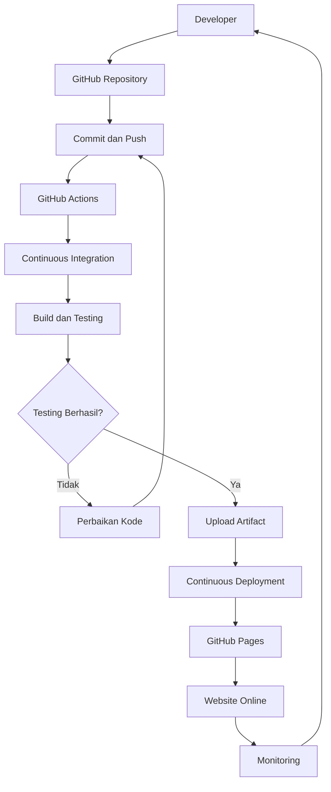
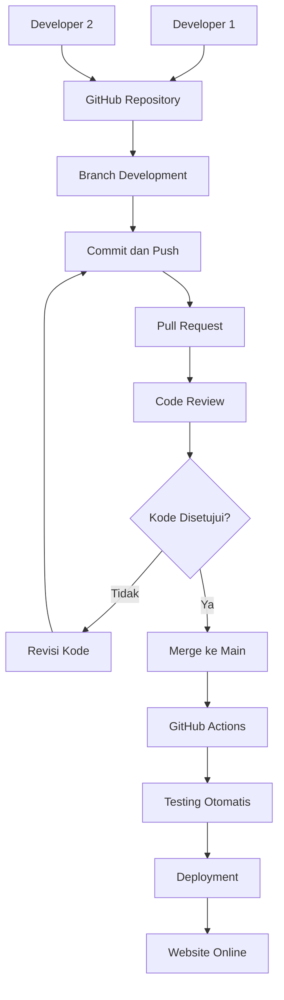

# IMPLEMENTASI PIPELINE CI/CD DAN KOLABORASI DEVOPS

## 1. Deskripsi Proyek

Proyek ini merupakan implementasi CI/CD dan kolaborasi DevOps menggunakan GitHub. Sistem ini bertujuan untuk mempermudah developer dalam mengembangkan aplikasi, melakukan pengujian kode secara otomatis, serta melakukan deployment website.

## 2. Teknologi yang Digunakan

- HTML
- CSS
- JavaScript
- Git
- GitHub
- GitHub Actions
- GitHub Pages
- Mermaid Diagram

## 3. DIAGRAM PIPELINE CI/CD



## 4. DIAGRAM KOLABORASI DEVOPS



## 5. ALUR KERJA CI/CD

1. Developer membuat kode aplikasi.
2. Developer mengirim kode ke GitHub.
3. GitHub Actions menjalankan pengujian otomatis.
4. Jika terdapat kesalahan, developer memperbaiki kode.
5. Jika pengujian berhasil, kode dapat digabungkan ke branch main.
6. GitHub Actions menjalankan proses deployment.
7. Website dipublikasikan melalui GitHub Pages.
8. Developer melakukan monitoring aplikasi.

## 6. PERINTAH GIT KOLABORASI

Membuat branch:

```bash
git checkout -b development
```

Menambahkan perubahan:

```bash
git add .
```

Menyimpan perubahan:

```bash
git commit -m "Implementasi DevOps CI/CD"
```

Mengirim kode ke GitHub:

```bash
git push origin development
```

Mengambil perubahan terbaru:

```bash
git pull origin main
```

## 7. CODINGAN APLIKASI DIGITAL KAMPUS

Berikut contoh aplikasi yang digunakan dalam implementasi CI/CD.

```html
<!DOCTYPE html>
<html lang="id">
<head>
<meta charset="UTF-8">
<meta name="viewport" content="width=device-width, initial-scale=1.0">
<title>Digital Kampus</title>

<style>
* {
    margin: 0;
    padding: 0;
    box-sizing: border-box;
    font-family: Arial, sans-serif;
}

body {
    background: #f1f5f9;
    color: #1e293b;
}

header {
    background: #164e8a;
    color: white;
    text-align: center;
    padding: 30px;
}

nav {
    background: #0f3155;
    padding: 15px;
    text-align: center;
}

nav a {
    color: white;
    text-decoration: none;
    margin: 10px;
}

.container {
    max-width: 1000px;
    margin: 30px auto;
    padding: 20px;
}

.card {
    background: white;
    padding: 25px;
    margin: 15px;
    border-radius: 10px;
    text-align: center;
}

button {
    background: #164e8a;
    color: white;
    padding: 10px 20px;
    border: none;
    border-radius: 5px;
    cursor: pointer;
}

footer {
    background: #0f3155;
    color: white;
    padding: 20px;
    text-align: center;
}
</style>
</head>

<body>

<header>
    <h1>DIGITAL KAMPUS</h1>
    <p>Sistem Informasi Akademik</p>
</header>

<nav>
    <a href="#beranda">Beranda</a>
    <a href="#pendaftaran">Pendaftaran</a>
    <a href="#krs">KRS</a>
    <a href="#nilai">Nilai</a>
</nav>

<div class="container" id="beranda">

    <h2>Selamat Datang di Digital Kampus</h2>

    <div class="card" id="pendaftaran">
        <h3>Pendaftaran Mahasiswa</h3>
        <p>Informasi pendaftaran mahasiswa baru.</p>
        <button onclick="pesan('Pendaftaran Mahasiswa')">
            Lihat Informasi
        </button>
    </div>

    <div class="card" id="krs">
        <h3>Pengisian KRS</h3>
        <p>Informasi rencana studi mahasiswa.</p>
        <button onclick="pesan('Pengisian KRS')">
            Lihat Informasi
        </button>
    </div>

    <div class="card" id="nilai">
        <h3>Pengumuman Nilai</h3>
        <p>Informasi hasil nilai mahasiswa.</p>
        <button onclick="pesan('Pengumuman Nilai')">
            Lihat Informasi
        </button>
    </div>

</div>

<footer>
    <p>Digital Kampus - Proyek DevOps 2026</p>
</footer>

<script>
function pesan(fitur) {
    alert("Anda memilih " + fitur);
}
</script>

</body>
</html>
```

## 8. KONFIGURASI GITHUB ACTIONS (CI/CD)

Berikut konfigurasi workflow untuk pengujian dan deployment otomatis.

```yaml
name: CI-CD Digital Kampus

on:
  push:
    branches: [main]

  pull_request:
    branches: [main]

permissions:
  contents: read
  pages: write
  id-token: write

jobs:

  testing:
    name: Continuous Integration
    runs-on: ubuntu-latest

    steps:
      - name: Checkout Repository
        uses: actions/checkout@v4

      - name: Testing HTML
        run: |
          test -f index.html
          grep -qi "<!DOCTYPE html>" index.html
          grep -qi "</html>" index.html
          echo "Testing Berhasil"

      - name: Upload Artifact
        if: github.event_name == 'push'
        uses: actions/upload-pages-artifact@v3
        with:
          path: '.'

  deployment:
    name: Continuous Deployment
    needs: testing
    if: github.event_name == 'push' && github.ref == 'refs/heads/main'
    runs-on: ubuntu-latest

    environment:
      name: github-pages
      url: ${{ steps.deploy.outputs.page_url }}

    steps:
      - name: Deploy Website
        id: deploy
        uses: actions/deploy-pages@v4

## 9. KESIMPULAN

Implementasi CI/CD dan kolaborasi DevOps membantu developer bekerja sama dalam mengembangkan aplikasi melalui GitHub. Dengan menggunakan GitHub Actions, proses pengujian dan deployment dapat dilakukan secara otomatis. Hal ini membuat pengembangan aplikasi menjadi lebih terstruktur, efektif, dan mudah dipantau.
